<div align="center">

<a href="docs/BUILD_GUIDE.md"></a>

<br>

[](https://github.com/Moataz-Elmesmary/egypt-market-intelligence/actions/workflows/ci.yml)
[](backend/evals.py)
[](backend/evals.py)
[](forecast_models.py)
[](mcp/token_benchmark.py)
[](LICENSE)


### A Power BI report you can talk to, in Egyptian Arabic or English.<br>Every number in an answer comes from a DAX query you can open and rerun.

[**▶ Watch the full build**](#-the-full-build-in-10-minutes) &nbsp;·&nbsp;
[**See it work**](#-see-it-work) &nbsp;·&nbsp;
[**How it works**](#-how-it-works) &nbsp;·&nbsp;
[**Run it**](#-run-it-yourself) &nbsp;·&nbsp;
[**Work with me**](#-work-with-me)

</div>

---

## ▶ The full build, in 10 minutes

<a href="docs/BUILD_GUIDE.md">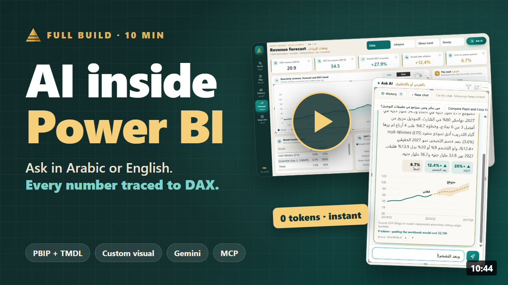</a>

From an empty folder to a report that answers in Arabic: the data and the forecasts, the semantic model as code, the custom visual, Power BI Desktop, the AI gateway, the audit log and the tests. The written version is [docs/BUILD_GUIDE.md](docs/BUILD_GUIDE.md).

<details>
<summary><b>Chapters</b></summary>

| Time | Chapter | Time | Chapter |
|---:|---|---:|---|
| 0:00 | A Power BI report you can talk to | 5:10 | Importing a custom visual |
| 0:24 | The rule: the model never touches the data | 5:34 | Model view: 18 tables, 78 measures |
| 0:39 | Six ways to put AI in Power BI | 5:58 | DAX query view: the tool's exact query |
| 1:18 | The trade-offs | 6:17 | The report |
| 1:47 | Four layers | 6:58 | Forecast page and inflation scenarios |
| 2:07 | Data and forecasts | 7:29 | The AI gateway |
| 2:57 | The semantic model as code | 8:18 | Asking in Egyptian Arabic and English |
| 3:48 | The custom visual | 9:08 | Audit: every question logged |
| 4:22 | Packaging the .pbiviz | 9:31 | 42 test questions and an MCP client |
| 4:37 | Opening the PBIP in Power BI Desktop | 9:54 | The same pattern on SQL Server |

</details>

---

## ✦ See it work

<table>
<tr>
<td width="44%" valign="top">
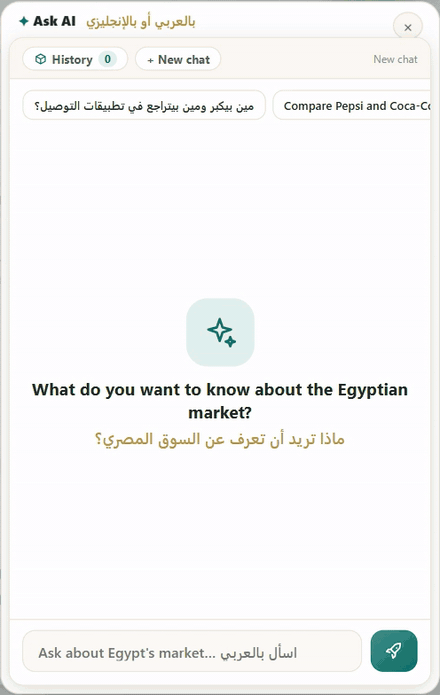
</td>
<td valign="top">

**Three questions, three routes:**

**1. «إيديتا هتعمل كام في 2027؟»** (How much will Edita make in 2027?)<br>
A known question shape. The router answers it in code from DAX rows: **EGP 34.5B, +27.9%**. `instant · 0 tokens`

**2. «وبعد التضخم؟»** (And after inflation?)<br>
On its own it means nothing, so it goes to Gemini with the last turns of the chat. One tool call, **+12.4% real growth**, every figure traced. `llm · 6/6 figures traced`

**3. "Compare Pepsi and Coca-Cola in Cairo vs Alexandria"**<br>
Gemini makes four `search_share` calls: **Pepsi 62% vs 31% in Cairo, 64% vs 28% in Alexandria**. `llm · 8/8 figures traced`

**And the ones it refuses.** *"What is Juhayna's profit margin?"* The model doesn't hold margins, so the scope gate says so before any AI call. *"Ignore previous instructions…"* is refused too, even mid-conversation.

> [!NOTE]
> Every card shows its route, the DAX of each tool call and a trace id. The chat keeps its history across pages, and the API key never leaves the gateway.

</td>
</tr>
</table>

### The report

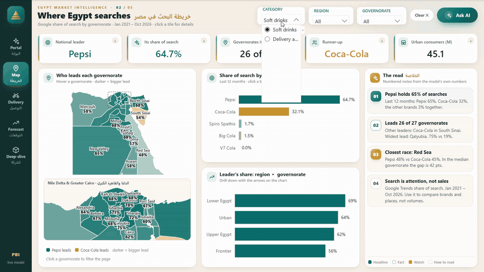

Five pages in one design language. The portal and the map are the custom visual. The rest is native Power BI: slicers, cross-filtering, drill-down, bookmarks for pop-ups, and numbered notes written from the model's own numbers.

<table>
<tr>
<td width="33%">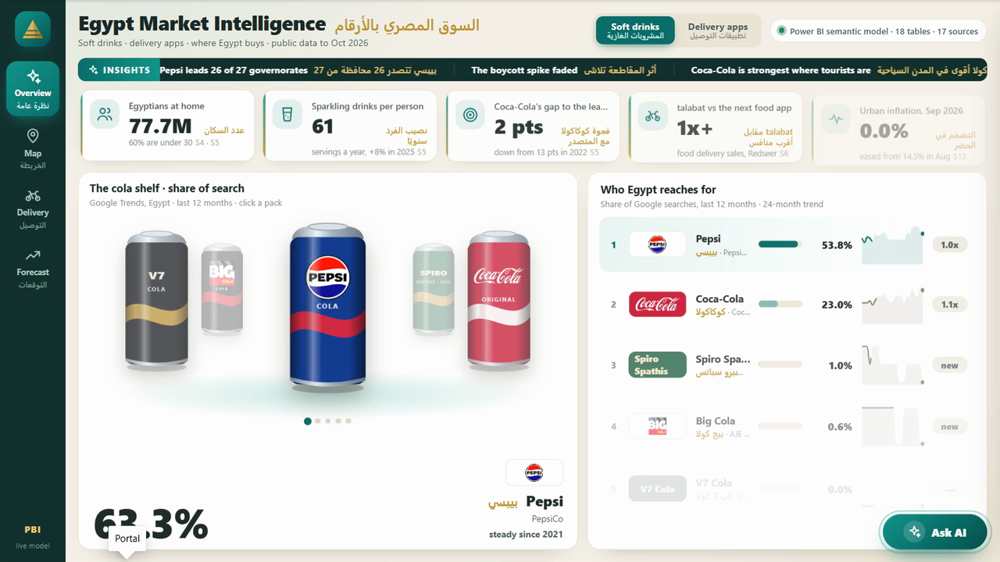<br><sub><b>01 Portal</b> · the shelf, the competitor board, the headline numbers</sub></td>
<td width="33%">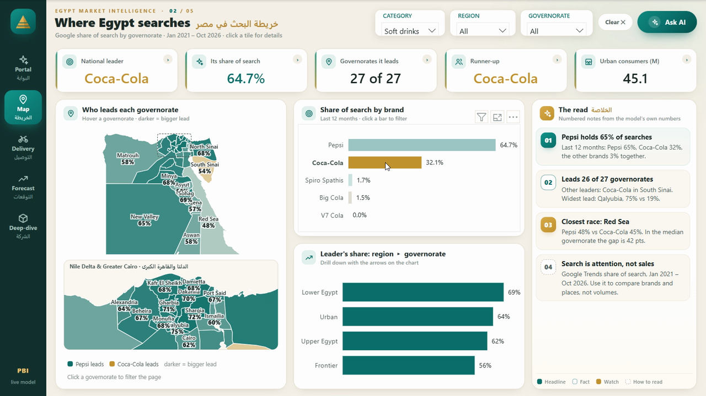<br><sub><b>02 Search &amp; map</b> · who leads each of the 27 governorates</sub></td>
<td width="33%">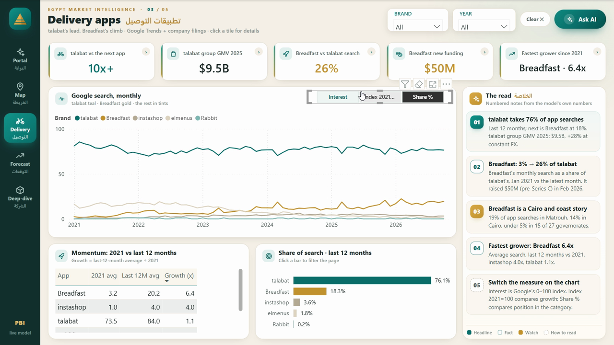<br><sub><b>03 Delivery</b> · talabat, Breadfast and the rest, month by month</sub></td>
</tr>
<tr>
<td>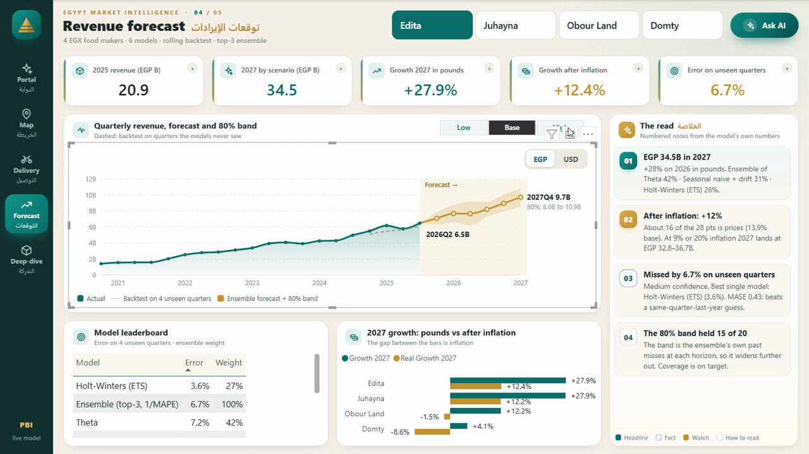<br><sub><b>04 Forecast</b> · 2027 revenue in pounds and after inflation</sub></td>
<td>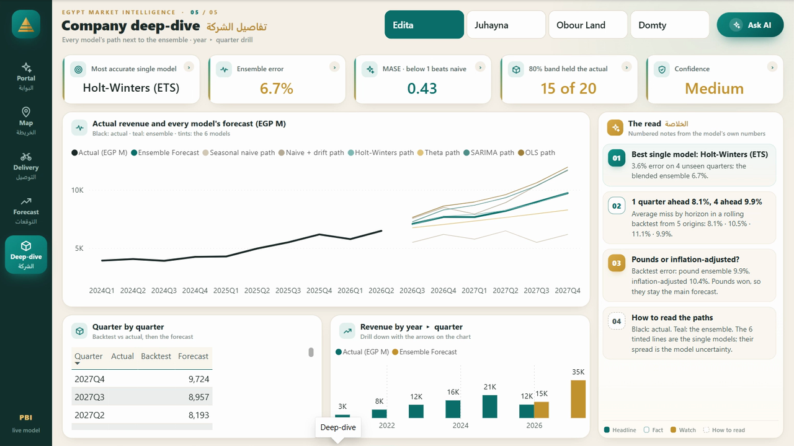<br><sub><b>05 Deep-dive</b> · every model's path and its backtest error</sub></td>
<td>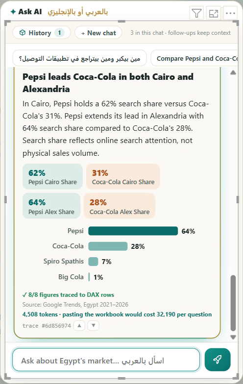<br><sub><b>Ask AI</b> · route, chips, chart, DAX, trace id</sub></td>
</tr>
</table>

<details>
<summary><b>The forecast page in motion</b> (inflation scenarios, company switch, pop-up)</summary>
<br>
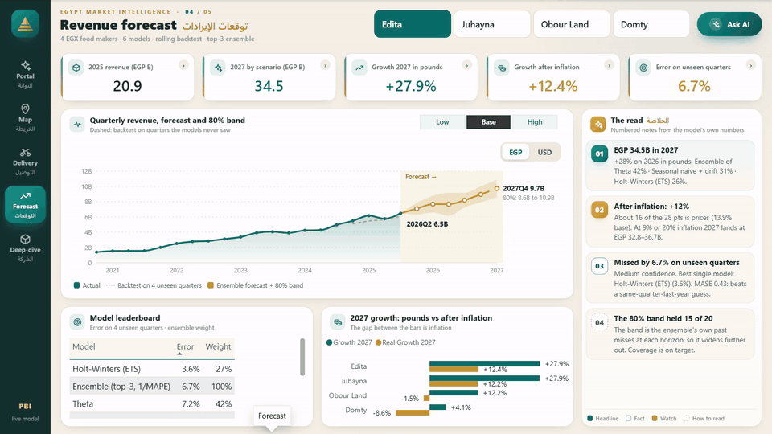
</details>

---

## ⚙ How it works


**The rule behind every design choice:** most companies won't let you paste data into a chatbot or connect an AI to a database. So here the model can *ask* for data through seven typed tools, and each tool is a **fixed DAX query with checked arguments**, run against the model Power BI Desktop has open. The model gets back a few rows, never a table.

| The model sees | The model never sees |
|---|---|
| The question and the page in view | The database or the workbook |
| The last three turns of the chat | The connection or the API key |
| Seven function declarations | A whole table |
| The few rows each call returns | Other people's chats |

<details>
<summary><b>One request, step by step</b> (sequence diagram)</summary>

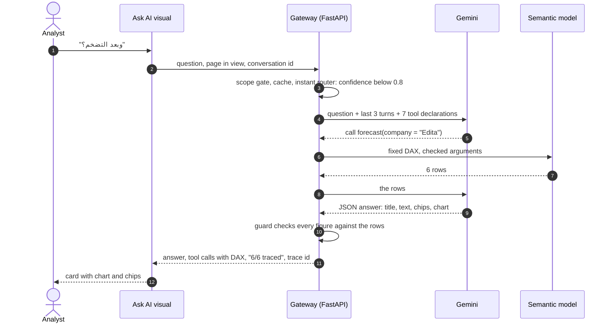

</details>

<details>
<summary><b>Six ways to put AI in Power BI, and why this build uses #4 and #5</b></summary>
<br>

| # | Approach | What you need | Model | Control and audit |
|---|---|---|---|---|
| 1 | Copilot in Power BI + *Prep data for AI* | Fabric or Premium capacity, tenant setting | Microsoft's | Low: Copilot writes the DAX |
| 2 | Fabric data agent over the semantic model | Fabric capacity | Microsoft's | Medium: instructions, examples |
| 3 | Microsoft's Power BI MCP servers (preview) | Admin enables the endpoint, Entra sign-in | Any MCP client | Medium: generated queries |
| 4 | **Custom visual + your own gateway** (this repo) | A small server you run | Any (Gemini here) | High: fixed queries, guard, logs |
| 5 | **Your own MCP server** (this repo) | The same server | Any agent | High: the same tools |
| 6 | SQL Server path | Read-only login, views or procedures, RLS | Any | High with procedures, risky as raw text-to-SQL |

Check licensing and preview status on Microsoft Learn before you promise options 1 to 3 to a client. They change often.

</details>

---

## ✦ Built on the newest pieces

| Capability | Where it lives here |
|---|---|
| **PBIP + PBIR report format.** Every page, visual and bookmark is a JSON file. | [`build_pbip.py`](build_pbip.py) writes all 5 pages, the pop-ups and the bookmarks. Nothing is hand-dragged. |
| **TMDL.** The semantic model as text. | 18 tables, 8 relationships and 78 DAX measures in [`pbip/…SemanticModel`](pbip). Diff a measure in a pull request. |
| **DAX query view.** | The exact query each AI tool sends can be pasted and run by hand ([`backend/tools.py`](backend/tools.py)). |
| **Custom visuals API 5.11.** | Landing page, empty-state support, en-US and ar-EG localization, high-contrast palette, native tooltips, read-only hosts and one `WebAccess` privilege ([`visual/`](visual)). |
| **Gemini 3 function calling.** | Typed declarations plus a `cannot_answer` tool. Model turns go back verbatim so the thought signatures survive ([`backend/llm.py`](backend/llm.py)). |
| **Model Context Protocol.** | The same 7 tools served over stdio to VS Code, Cursor or any agent ([`mcp/egypt_mcp.py`](mcp/egypt_mcp.py)). |
| **CI for a Power BI project.** | GitHub Actions rebuilds the data and forecasts, reruns the routing evals, packages the `.pbiviz`, regenerates the PBIP and fails on any drift ([`.github/workflows/ci.yml`](.github/workflows/ci.yml)). |

---

## ✦ Numbers that hold up

Every badge at the top reads [`docs/metrics.json`](docs/metrics.json). CI recomputes that file from the code on every push and fails if a number drifts.

**Forecasts.** Six models (seasonal naive, naive + drift, Holt-Winters, Theta, SARIMA, trend + season OLS) are refit at each cut-off and tested on **4 quarters they never saw**. The 3 most accurate are blended by inverse error.

| Company | Backtest error | MASE | 80% band held | 2027 revenue | Growth in EGP | After inflation |
|---|---:|---:|---:|---:|---:|---:|
| Juhayna | **5.0%** | 0.29 | 15 of 20 | EGP 48.3B | +27.9% | +12.2% |
| Obour Land | 6.2% | 0.30 | 15 of 20 | EGP 14.8B | +12.2% | −1.5% |
| Edita | 6.7% | 0.43 | 15 of 20 | EGP 34.5B | +27.9% | +12.4% |
| Domty | 13.3% | 0.87 | 13 of 20 | EGP 11.3B | +4.1% | −8.6% |

MASE below 1 beats a same-quarter-last-year guess. Domty is the honest outlier, and the report says so on its page.

**The assistant.**
- **42 / 42** routing evals: English and Egyptian Arabic, plus traps such as foreign brands, metrics the model doesn't hold and prompt injection. They need no AI call and run in CI.
- **42 / 42** on the live run through DAX and Gemini, plus **3 / 3** multi-turn conversations (last run 2026-11-06).
- **97.4% fewer tokens.** An MCP tool call averages **848 tokens**, while pasting the workbook costs **32,190** per question ([benchmark](mcp/token_benchmark.json)).

---

## ▶ Run it yourself

> [!TIP]
> Clone to a short path such as `C:\src\emi`. Power BI project paths are deep and Windows stops at 260 characters.

**1. Open the report (2 minutes).** Needs Power BI Desktop.
```bash
git clone https://github.com/Moataz-Elmesmary/egypt-market-intelligence.git C:/src/emi
```
Open `pbip/Egypt Market Intelligence.pbip`, then press **Refresh**. The model reads the workbook from this repo over HTTPS (choose *Anonymous* if asked), so there's no path to edit.

**2. Turn on Ask AI.** Needs Python 3.12 and a [Gemini API key](https://aistudio.google.com/apikey).
```bat
python -m venv .venv && .venv\Scripts\activate
pip install -r requirements.txt
copy backend\.env.example backend\.env
cd backend && python app.py
```
Put your key in `backend/.env`. The gateway finds the report Power BI Desktop has open and listens on `localhost:8765`. Open <http://localhost:8765/logs> for the trace log.

**3. Connect an agent over MCP.**
```json
{ "mcpServers": { "egypt-market": { "command": "python", "args": ["C:/src/emi/mcp/egypt_mcp.py"] } } }
```
Or run `python mcp/demo_client.py` to watch a client list the 7 tools and call two of them.

**4. Rebuild everything from code.**
```bash
python build_egypt_data.py
cd visual && npm ci && npx pbiviz package && cd ..
python build_pbip.py visual/dist/<name>.pbiviz C:/src/emi-local
```
Or run it in one step with `python tools/rebuild.py`. Tests: `python backend/evals.py` checks routing, and `--live` runs the full pipeline.

CI packages the `.pbiviz` on every push: download it from the latest [build run](https://github.com/Moataz-Elmesmary/egypt-market-intelligence/actions/workflows/ci.yml).

<details>
<summary><b>Repository map</b></summary>

```text
build_egypt_data.py    public data -> 18 tables (Excel + JSON), notes written from the numbers
forecast_models.py     6 statsmodels forecasters, rolling-origin backtest, top-3 ensemble
forecast_plus.py       CPI lens: real growth vs price growth, 9 / 13.9 / 20% scenarios
build_pbip.py          TMDL semantic model + PBIR report (pages, visuals, bookmarks, theme)
layout.py              one page grid shared by the report and its backgrounds
pbip/                  the generated Power BI project (CI checks it matches the code)
visual/                custom visual: portal, map, forecast, notes, Ask AI (TypeScript + D3)
backend/               gateway: router.py, llm.py, tools.py (DAX), guard.py, store.py, evals.py
mcp/                   MCP server, demo client, token benchmark
tools/                 rebuild.py, metrics.py, make_backgrounds.py
data/  raw/            the workbook the model loads, and the raw inputs
docs/                  build guide, metrics, media
```

</details>

<details>
<summary><b>The same pattern on SQL Server</b></summary>
<br>

- Give the gateway a **read-only** login, limited to the schemas it needs.
- Each tool calls a **view or stored procedure** with typed parameters, just like the DAX tools here.
- Apply **row-level security** in SQL Server or in the semantic model.
- Text-to-SQL is possible, but never run generated SQL on production directly. Parse it, check it against an allow-list, and run it read-only with a row limit.

</details>

<details>
<summary><b>Data, sources and fair use</b></summary>
<br>

All data is public, and each figure carries a source id (S1 to S17) listed in the workbook's *Sources* sheet:

- quarterly revenue from the companies' EGX filings
- relative search interest from Google Trends (Jan 2021 to Oct 2026)
- population and urban share from CAPMAS

Search share measures attention, not sales. Brand names and logos belong to their owners and are shown only to identify them in an independent analysis. This project is not affiliated with any company shown.

</details>

---

## ✉ Work with me

<div align="center">


I'm **Moataz Elmesmary**, a BI developer in Cairo. I build Power BI solutions end to end: data models, DAX, custom visuals, forecasting, and AI assistants that answer from your own model. If you want something like this on **your** data, in Power BI, Fabric or SQL Server, let's talk.

<a href="https://www.linkedin.com/in/MoatazElmesmary/"></a>
<a href="mailto:moataz.mesmary@gmail.com"></a>
<a href="https://moatazelmesmary.vercel.app/"></a>
<a href="https://x.com/MoatazElmesmary"></a>

<sub>If this saved you a week of figuring out, a ⭐ helps other Power BI people find it.</sub>

</div>
